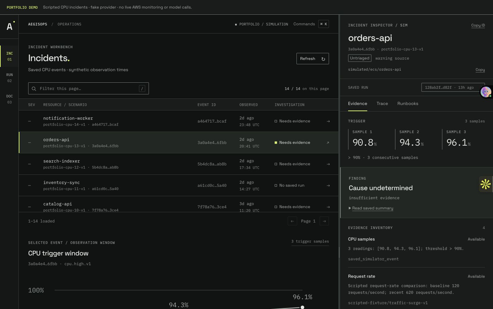
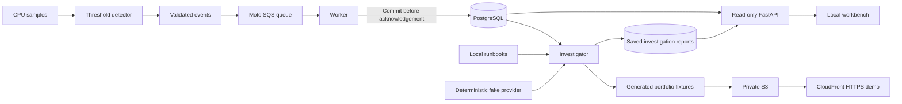

# AegisOps

[](https://github.com/Amitsingh-nsut2027/aegisops/actions/workflows/checks.yml)

**A CPU incident investigation workbench with traceable evidence and saved investigation reports.**

[Live demo](https://d2mmk7avpz0dbe.cloudfront.net) · [Architecture](docs/PROJECT_WALKTHROUGH.md) · [Interview walkthrough](docs/RESUME.md)

AegisOps turns a sustained CPU threshold breach into a structured event, persists it without duplicate rows on replay, and records an investigation with evidence sources, a workflow trace, and revisioned runbook excerpts. The interface lets an operator follow that event from detection to the saved report.



## Try the demo in one minute

1. Open the [incident workbench](https://d2mmk7avpz0dbe.cloudfront.net/#incidents) and select **orders-api**.
2. In the right inspector, switch between **Evidence**, **Trace**, and **Runbooks**. Change **Saved run** to compare snapshots with different evidence availability.
3. Choose **RUN** to browse investigation history. Use the next-page arrow to see older reports, or **Cmd/Ctrl+K** to navigate with commands.

The public demo contains **14 scripted incidents and 33 saved report snapshots**. It runs from static fixtures generated by the local workflow. It requires no account and makes no model calls or AWS infrastructure changes. The Python/PostgreSQL backend runs locally; it is not hosted behind the public demo.

## What is implemented

| Area | Behavior |
| --- | --- |
| Detection | Alert after three consecutive CPU samples strictly above 90%; one alert per uninterrupted episode |
| Event delivery | Local Moto SQS-compatible queue, validation before persistence, acknowledgement after commit, dead-letter handling |
| Persistence | Deterministic event identities, PostgreSQL uniqueness, replay without duplicate event rows, Alembic migrations |
| Investigation | Bounded provider contract, schema/citation validation, retry/fallback, evidence availability inventory, saved report per invocation |
| Guidance | Deterministic tag retrieval from project-authored runbooks; saved excerpts and content revisions |
| API | FastAPI list/detail routes, bounded pagination, development viewer JWTs, SELECT-only database role |
| Interface | Incident and investigation views, filtering, trace/evidence tabs, copy controls, keyboard commands, resizable inspector, mobile detail navigation |
| Deployment | CloudFormation, private S3 origin, CloudFront origin access control, HTTPS, scoped deployment identity, artifact hash verification |

**Current limits:** telemetry and investigation output are simulated. A Bedrock transport adapter has offline contract tests, but live inference is disabled. There is no autonomous agent loop, production login, approval/execution workflow, or remediation. Tests establish functional behavior, not production scale or improved recovery time.

## Architecture



The local queue emulator tests delivery behavior without AWS credentials. Stable event IDs make database writes idempotent; they do not imply exactly-once delivery. A CPU symptom and a nearby deployment are evidence to inspect, not proof of root cause. See the [design decisions and failure behavior](docs/PROJECT_WALKTHROUGH.md).

## Run locally

Requires **Docker Desktop with its engine running**, Docker Compose, and Python 3.9+ on the host. The backend runs with Python 3.12 inside Docker. No AWS account or paid AI key is needed.

```sh
git clone https://github.com/Amitsingh-nsut2027/aegisops.git
cd aegisops
python3 scripts/start_workbench.py
```

Keep that terminal running. Open [localhost:5173](http://127.0.0.1:5173). Startup creates missing local secret files, migrates the database, creates restricted application roles, and issues a private viewer token. A fresh checkout has no events yet.

In another terminal, seed a scenario and save an investigation:

```sh
docker compose run --rm queue python queue_demo.py publish --scenario-id portfolio-walkthrough-v1
docker compose run --rm queue python queue_demo.py work
docker compose run --rm investigator python investigator_cli.py --evidence-scenario traffic-surge-v1
```

Refresh the workbench. Replaying the same scenario does not add duplicate events; each investigator invocation intentionally adds an independent report. Select **RUN** for those reports.

Viewer sessions expire after 15 minutes. To renew the existing local viewer session, run this and click **Retry** in the workbench:

```sh
python3 scripts/create_viewer_token.py
```

The API documentation is at [localhost:8000/docs](http://127.0.0.1:8000/docs). Protected endpoints require the private token stored in `.local/viewer-token.txt`; the frontend bridge reads it server-side and never returns it to the browser. Keep `.env*` and `.local/` private.

Stop the frontend with **Ctrl+C**. To stop containers while retaining database data:

```sh
docker compose --profile api --profile queue down
```

Avoid `down -v` unless you intend to delete the local database volume.

## Verification

```sh
# Backend unit/contract checks; no network or AWS calls inside the test container
docker build -t aegisops-backend:local backend
docker run --rm --network none -v "$PWD:/workspace:ro" -w /workspace \
  -e PYTHONPATH=/workspace/backend aegisops-backend:local \
  python -B -m unittest discover -s tests

# Frontend data/format checks and module syntax (Node.js 22+)
cd frontend
npm test
npm run check
cd ..

# Actual PostgreSQL read-role checks, with the local stack running
docker compose run --rm --no-deps -v "$PWD/tests:/tests:ro" api \
  python -B -m unittest discover -s /tests/integration -p test_api_reader.py
```

CI builds the backend image, runs isolated unit/contract checks and frontend checks, then generates and verifies the static portfolio artifact. It does not deploy AWS resources. Browser interaction checks and responsive captures are documented in [deployment evidence](docs/notes/deployed-portfolio.md) and [UI review notes](docs/design/review-screen-02/POLISH-REPORT.md).

## Deploy the static portfolio

The public release is separate from the local authenticated workbench. [The deployment guide](infra/aws/DEPLOYMENT.md) covers artifact generation, account-scoped permissions, credit/budget preflight, publishing, and teardown. Planning is offline by default; publishing is explicit. [Cost assumptions](infra/aws/COST-ESTIMATE.md) describe the expected small-demo usage and its limits. Budget alerts are not a hard spending cap.

## Explore the code

| Path | Purpose |
| --- | --- |
| `backend/simulator.py`, `incidents.py` | Detection and event identities |
| `backend/queue_worker.py`, `event_schema.py` | Delivery, validation, persistence boundary |
| `backend/investigator.py`, `llm_provider.py` | Investigation and validated provider output |
| `backend/run_repository.py`, `migrations/` | Saved report history and schema evolution |
| `backend/auth.py`, `api.py` | Local viewer authentication and read routes |
| `frontend/` | Browser UI and local/public data clients |
| `scripts/build_portfolio.py` | Synthetic artifact generation and file manifest |
| `infra/aws/` | Dedicated static hosting stack and scoped policy example |
| `tests/` | Unit, contract, and database integration checks |

[Learning guide](docs/LEARNING_GUIDE.md) · [Interview Q&A](docs/INTERVIEW_QA.md) · [Design system](DESIGN.md) · [Detailed progress](docs/PROGRESS.md)

Built by [Amit Singh](https://github.com/Amitsingh-nsut2027). Bundled fonts retain their original licenses in `frontend/assets/fonts/`.
