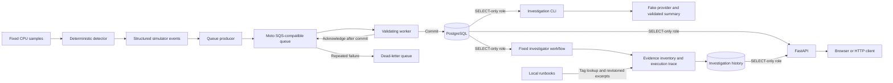

# Project walkthrough — explain the system from first principles

## The problem
An operator needs to turn infrastructure symptoms into traceable incidents and eventually safe remediation decisions. Before introducing AI, we need reliable collection, detection, event delivery, storage, and visibility. AI reasoning cannot compensate for events that are lost, duplicated, malformed, or missing evidence.

## Current architecture

Moto, Docker, and PostgreSQL run locally. The queue behaves like an AWS integration test double; it does not provide evidence of actual AWS IAM, durability, or latency. A direct importer also remains available for the earlier persistence exercise.

## Follow one event
1. `simulator.py` receives CPU values. It increments a streak for values strictly above 90, resets on values at or below 90, and emits an alert only once per uninterrupted episode after three high readings.
2. `incidents.py` converts an alert into a versioned event with a resource ID, simulated observation time, threshold/window, and the three CPU readings that triggered it. The event ID is a hash of replay inputs.
3. `queue_demo.py publish` creates the local queue/DLQ if needed and sends JSON events. Detection and processing are now separate operations.
4. `queue_worker.py` receives a batch. Receipt hides a message temporarily; it is not successful processing yet.
5. `event_schema.py` validates JSON with Pydantic before storage. It rejects extra fields, invalid types, non-simulation sources, naive timestamps, invalid CPU values, inconsistent evidence, and IDs that do not match event contents.
6. `persist_incidents.py` inserts through SQLAlchemy inside a transaction. The primary key enforces unique event IDs. PostgreSQL's conflict handling skips a replay rather than creating a second row.
7. Only after the transaction commits does the worker acknowledge the message using its receipt handle. If acknowledgement fails after commit, delivery can repeat; the database still prevents a second event row.
8. `api.py` handles a GET request. Event endpoints first validate a viewer JWT and check events:read permission. Query validation rejects invalid limits before SQL. The repository fetches a bounded page, the response model shapes the JSON, and request logging records a generated request ID, authenticated subject, and timing without token contents.

## The database boundary
The separate investigation CLI now reads one saved event and exercises a provider contract with deterministic fake output. It validates structure and citations, retries once on invalid output, then falls back. Root cause remains null. This is not model inference; see [Phase 5](notes/phase-05-provider.md).

The [Phase 6 workflow](notes/phase-06-investigator.md) wraps that provider with event validation, an evidence availability inventory, and an observable execution trace. Each invocation gets a new run ID and returns needs_evidence. The CLI now commits an append-only report snapshot before printing success. The API reads that [history](notes/investigation-history.md) through JWT-protected list/detail routes. The investigator uses a separate INSERT-capable role; the API remains SELECT-only. Resumable jobs and model-directed tools are not implemented.

The `incident_events` table is an event journal. It is not yet an incident lifecycle table with investigation, approval, and recovery states. Each row contains queryable identity/time columns and a JSONB evidence payload. `observed_at` is synthetic scenario time; `received_at` is actual database receipt time. Alembic stores the schema revision separately.

The API uses the `aegis_api` login. It has SELECT on this table, no table write grants, and no public-schema CREATE privilege. It also defaults transactions to read-only. Startup checks reject the wrong principal or detected write grants. The API receives its own password, not the migration administrator password. Migration/import tools still use the local administrator for this learning stage; a restricted writer remains future work.

## Important distinctions
- Runbook excerpts are project-authored guidance, not observed evidence or model output. Structured tags select a bounded set; excerpts and content hashes are saved with each report. No runbook actions are executed and no real RAG generation occurs. See [runbook notes](notes/local-runbooks.md).
- Supplemental request/deployment/log evidence is available only through an explicit scripted scenario. Its event/resource/time scope is validated and its source is labeled as a fixture. Having all demo evidence kinds attached still does not establish root cause. See [evidence notes](notes/simulated-evidence.md).
- A CPU symptom is not a root cause. High CPU can follow traffic, a hot loop, throttling-related behavior, or deployment changes. This detector does not decide which happened.
- Three readings are not automatically three minutes of impact. With one-minute spacing, the first and third samples are two minutes apart; real telemetry needs explicit timestamps, missing-data policy, and aggregation windows.
- An alert is emitted once per CPU episode in one batch. The current detector resets between calls; persistent streaming state is not implemented.
- Stable IDs enable idempotent replay. A hash does not authenticate the sender and does not guarantee exactly-once delivery or exactly-once external actions.
- A live process is not necessarily ready. `/health` answers whether the app responds; `/ready` checks access to the event table.
- Database permissions and HTTP permissions are separate. The API now checks locally issued viewer JWTs, but has no production user-login/identity provider and remains bound to localhost only. A token subject issued by a trusted local developer is not independently verified human identity.

## What happens when things fail?
| Failure | Current behavior | Why |
|---|---|---|
| Isolated CPU spike | No incident | Avoid alerting on one transient reading |
| Continuing high CPU | One alert per episode | Suppress duplicate symptom alerts |
| Bad queue message | Rejected, left unacknowledged, then DLQ after repeated receives | Preserve failures for investigation |
| Database insert fails | Transaction fails; message is not acknowledged | Retry without losing work |
| Worker stops after commit | Message can return; replay inserts no extra row | Database-enforced idempotency |
| Unknown event ID | HTTP 404 | Valid request, missing resource |
| Missing/invalid/expired bearer token | HTTP 401 | Event reads require valid authentication |
| Valid token with unassigned role | HTTP 403 | Authentication does not imply event-read permission |
| Invalid pagination | HTTP 422 | Reject invalid input before querying |
| Database fails during API request | HTTP 503 with generic response | Signal dependency unavailability without leaking SQL or credentials |
| Moto restarts | Queue state is cleared | Emulator is in-memory; republish simulations |

## Decisions you should be able to defend
We use deterministic code for thresholds because the rule is explicit and testable. PostgreSQL combines transactional event storage with future relational workflow data; JSONB retains evidence without making every field a column. SQLAlchemy constructs parameterized SQL, and Alembic versions schema changes. A queue decouples production from consumption but introduces retries and duplicates, so idempotency belongs in the database. FastAPI supplies typed HTTP contracts and automatic API documentation. Keeping the first interface read-only makes this slice easier to verify and limits its impact.

Alternatives remain conditional: OpenSearch is unnecessary at today's scale; a free-form agent loop would make safety and replay harder to reason about; direct synchronous detection-to-database writes were useful for the first exercise but couple producer availability to database availability.

## What we have actually measured
Baseline detector: only sample 7 alerts. Reset/rearm scenario: samples 3 and 9 alert. A direct import inserted two rows; replay inserted zero. A new queued scenario inserted two and acknowledged two; replay acknowledged duplicates without extra rows. The API currently exposes four seeded simulation events across the two scenarios. These are functional correctness checks, not throughput benchmarks or measured reductions in incident recovery time.

## A truthful 45-second explanation

“AegisOps turns a CPU threshold breach into a structured incident record and a traceable investigation. I implemented deterministic detection, an SQS-compatible local queue, validated delivery, and idempotent PostgreSQL persistence. Each investigation saves an evidence inventory, a bounded validated summary, a workflow trace, and revisioned runbook guidance. A read-only FastAPI service and interactive workbench expose those records. The public portfolio is a labelled simulation served by CloudFront with a private S3 origin; the full backend runs locally. Live AI, telemetry collectors, production identity, and remediation remain future work.”

See [resume notes](RESUME.md) for the demo sequence and claim boundaries.

## Code reading map
Read `simulator.py` → `incidents.py` → `queue_demo.py` → `queue_worker.py` → `event_schema.py` → `persist_incidents.py` → `database.py` → `api.py` → `event_repository.py`. Then compare `test_monitoring.py`, `test_queue.py`, `test_api.py`, and the integration tests. Schema changes are under `backend/migrations`.
